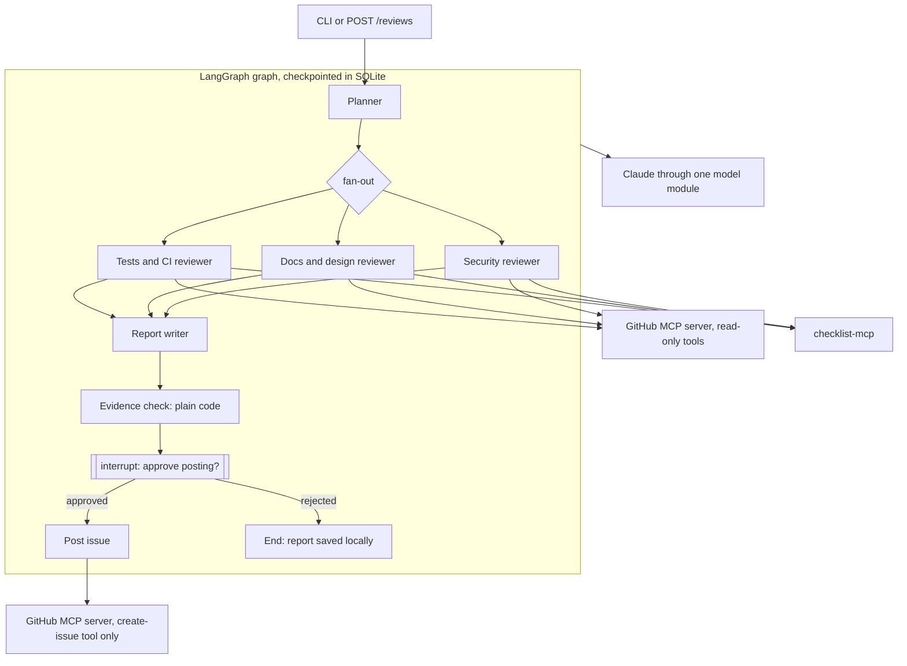
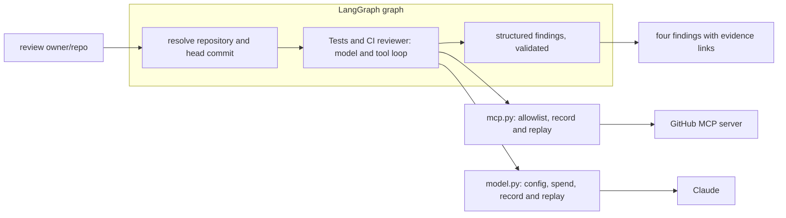

# Roadmap

`repo-readiness-reviewer` reviews a public GitHub repository for production readiness. A LangGraph graph sends
specialist agents to read the repository through the GitHub MCP server; every finding is `pass`, `fail` or
`unknown` and links to its evidence. Posting the report as an issue needs a human approval.

The project is built one task at a time. Each task is one pull request, and a milestone's task breakdown is written
and reviewed before its code.

## Milestones

| Milestone | Scope | Done means | Effort | Status |
|---|---|---|---|---|
| **M1 One reviewer** | Repository skeleton, model module with record and replay, GitHub MCP connection, the Tests and CI reviewer, structured findings, CLI | `review <owner/repo>` prints four findings with evidence links for a real repository; CI green. Demonstrable alone | 8 h | in progress since 23 Nov 2026 |
| **M2 Three reviewers** | Planner, parallel fan-out, the Docs and design reviewer, the Security reviewer, `checklist-mcp`, report writer, evidence check | A full twelve-check Markdown report for any public repository; a contract test on the GitHub tool names; ADR on supervisor versus handoffs | 9 h | |
| **M3 Approval and evaluation** | SQLite checkpointer, approval interrupt, posting to a sandbox repository, the 15-repository labelled set, scorer, CI gate | A review pauses, survives a restart and posts after approval; `evals/REPORT.md` exists with accuracy per check | 8 h | |
| **M4 Ship** | Tracing with tokens and cost, cost cap enforcement across agents, Dockerfile and Compose, FastAPI endpoints, README with results first, tag `v0.1.0` | Release checklist below ticked | 5 h | |

### Release checklist (`v0.1.0`)

- [ ] Repository public, tag `v0.1.0`, CI green on the tag
- [ ] A LangGraph graph with a planner, three parallel reviewers and a report writer
- [ ] The GitHub MCP server consumed behind allowlists, and `checklist-mcp` present with a test
- [ ] The approval pause tested, including resume after a restart
- [ ] `evals/REPORT.md` with accuracy per check, the `unknown` share, cost per review and the remaining errors
- [ ] ADRs accepted, and a README that states the limits

### Scope cuts, in order

If time runs short:

1. The FastAPI app (keep the CLI).
2. Langfuse (keep a JSON-lines run log with tokens and cost).
3. Posting to GitHub becomes saving a file; the approval pause stays.
4. Twelve checks become nine.

Never cut: the labelled set and its report, the evidence check, the recorded fixtures, `checklist-mcp`.

### Out of scope

Code-quality or bug review of the source itself, private repositories, automatic fixes or pull requests, a web
interface.

## Target architecture

What M1 builds of it: the entry point (CLI only), the graph with a single reviewer branch, the model module, the
GitHub MCP connection with a read-only allowlist, and the Tests and CI reviewer. The checks are read from a YAML
file that M2 moves behind `checklist-mcp`.

## The checklist

Twelve yes-or-no checks. M1 implements the first group.

| Group | Checks | Milestone |
|---|---|---|
| Tests and CI | A CI workflow exists; CI runs tests; integration tests exist; the default branch's last CI run passed | M1 |
| Docs and design | The README explains how to run it; the architecture is described; design decisions are recorded; a licence is present | M2 |
| Security hygiene | Dependency updates are automated; no secrets-like files are committed; a security policy or scanning workflow exists; dependencies are pinned or locked | M2 |

## Pinned versions

Checked on 23 Nov 2026 against PyPI and the GitHub MCP server's releases. `pyproject.toml` holds compatible ranges
from these versions upward and `uv.lock` holds the exact versions (task 1.1); CI installs with `uv sync --locked`.
A later bump is its own task and, if it changes what the model sees, re-records fixtures.

| Artifact | Version on check date | Used from | Note |
|---|---|---|---|
| Python | 3.13 (floor 3.12) | M1 | `langchain-anthropic` needs 3.11 or later |
| `uv` | 0.11.6 installed locally | M1 | CI installs it with `astral-sh/setup-uv` |
| `langgraph` | 1.2.24 | M1 | Stay on the 1.x line |
| `langchain-anthropic` | 1.7.12 | M1 | Task 1.4 verifies how it sends structured output |
| `langchain-core` | 1.8.4 | M1 | |
| `langchain-mcp-adapters` | 0.3.2 | M1 | Pre-1.0: pin exactly |
| `mcp` (Python SDK) | 1.30.0 locked (2.3.0 is out) | M1 as a client, M2 as a server | `langchain-mcp-adapters` 0.3.2 requires `mcp<2`, so the 1.x line it is; must stay at 1.23.0 or later. Moving to 2.x waits for an adapters release that allows it |
| `pydantic-settings` | 2.16.3 | M1 | Added in 1.1 for the settings object |
| `hatchling` | 1.27 or later | M1 | Build backend |
| GitHub MCP server | v2.2.0 (16 Nov 2026) | M1 | See decision 3 for how it is run |
| `pydantic` | 2.14.4 | M1 | |
| `typer` | 0.29.2 | M1 | |
| `pyyaml` | 6.0.4 | M1 | |
| `ruff` | 0.17.6 | M1 | Dev dependency |
| `pytest` | 9.2.0 | M1 | Dev dependency |
| `langgraph-checkpoint-sqlite` | 3.1.3 | M3 | Re-check at M3 kick-off |
| Langfuse | not checked | M4 | Check at M4 kick-off |
| Model | `claude-opus-5-5` | M1 | In configuration, never in code |

## M1 task breakdown

**Done means:** on a machine with a GitHub token and an Anthropic API key, `uv run review <owner/repo>` reviews a
real public repository and prints four findings (one per Tests and CI check), each `pass`, `fail` or `unknown`,
each `pass` or `fail` with an evidence link pinned to the reviewed commit, followed by tokens and cost. The same
review replays from committed fixtures with no network, no key and no cost, and that replay is a test. CI
(GitHub Actions: Ruff, pytest, replay) is green on `main`. ADRs 0001 and 0002 are accepted. The README says what
runs and what does not yet.

Branches are named `m1/<task>`.

| # | Task | Output | Status |
|---|---|---|---|
| 1.1 | **Skeleton and pins.** `pyproject.toml` (package `reviewer`, `src` layout, Python 3.12+, console script `review`), dependencies from the pins table locked in `uv.lock`, Ruff configuration (lint and format), pytest configuration, `.env.example` naming the two variables (`ANTHROPIC_API_KEY`, `GITHUB_TOKEN`) with no values, a settings object that reads them. Test: the package imports and the settings load from an environment without secrets. | `pyproject.toml`, `uv.lock`, `src/reviewer/`, `tests/` | done: 8 tests. `mcp` locked at 1.30.0, not 2.3.0, because `langchain-mcp-adapters` 0.3.2 requires `mcp<2` (pins table). `review` exists but only `--version` works until 1.9 |
| 1.2 | **CI.** GitHub Actions workflow on push and pull request: `uv sync --locked`, Ruff check, Ruff format check, pytest. No secrets in the workflow; it must pass with no API key. Dependabot for `uv` and GitHub Actions. Needs the user: push `main` and confirm Actions is enabled. | `.github/workflows/ci.yml`, `.github/dependabot.yml` | done: Python 3.12 and 3.13 matrix, actions pinned to commit SHAs (`checkout` v7.0.1, `setup-uv` v10.4.0, uv 0.11.6), read-only `GITHUB_TOKEN`, no secrets. Dependabot weekly for `uv` and Actions; it ignores `mcp` 2.x (pins table) |
| 1.3 | **ADR 0001 and the ADR index.** Scope and fixed stages: twelve fixed checks, code routes and models only read and judge, three result values with `unknown` preferred to guessing, what is out of scope. Index lists the planned ADRs (0002 in 1.5, 0003 in M2). | `docs/adr/README.md`, `docs/adr/0001-scope-and-fixed-stages.md` | |
| 1.4 | **Findings schema and the checks file.** Pydantic models: `Finding` (check id, result `pass`/`fail`/`unknown`, evidence path or URL, short reason) and `ReviewResult`. Validation rule: `pass` and `fail` need evidence, `unknown` does not. `checks.yaml` with the four Tests and CI checks: id, question, definition, evidence required, an example of each result. Loader with schema validation. Tests: valid and invalid findings, the loader rejects a malformed file, the four ids are present. | `src/reviewer/findings.py`, `src/reviewer/checks.py`, `src/reviewer/checks.yaml` | |
| 1.5 | **Model module and ADR 0002.** The only place that calls the model. Reads model id, effort and the spend cap from configuration; counts tokens and cost per call from a price table in configuration; three modes: `live`, `record` (saves each request and response under a fixture directory) and `replay` (serves them back and fails loudly on a request it has no recording for). Follows the Claude API rules: no thinking budget, effort set explicitly, no forced tool choice, no temperature, assistant messages kept unchanged, stop reason checked before content. Verifies from the installed `langchain-anthropic` source how structured output is sent and records the finding in the ADR. Tests use a fake chat model: record then replay returns the same messages, a missing recording fails, the spend counter adds up, a refusal stop reason surfaces as an error value, no key is needed in replay. | `src/reviewer/model.py`, `docs/adr/0002-record-and-replay.md` | |
| 1.6 | **GitHub MCP connection.** `mcp.py` opens the GitHub MCP server through `langchain-mcp-adapters`, exposes only the tools on the calling agent's allowlist (read file contents, list directory, list workflow runs: exact tool names read from the pinned server, not from memory), and refuses any tool outside it. The same record and replay modes as the model module, so a replayed review makes no network call. A cache of file reads within one review. Tests: an allowlisted tool is exposed and a write tool is not, even when the server offers it (fake server); record then replay returns the same tool results. One live smoke test, skipped unless `GITHUB_TOKEN` is set, lists the root of a public repository. Needs the user: a read-only token. | `src/reviewer/mcp.py` | |
| 1.7 | **Review state and target resolution.** `state.py`: the typed review state (repository, head commit, findings merged by a reducer, spend). A first graph node resolves `owner/repo` to its default branch and head commit SHA through the MCP connection; every later read and every evidence link uses that SHA. Tests: the reducer merges findings from two branches without loss or duplicates; a malformed `owner/repo` is rejected before any call; a missing repository ends the review with a clear error. | `src/reviewer/state.py`, `src/reviewer/graph.py` | |
| 1.8 | **Tests and CI reviewer.** `agents/tests_ci.py`: prompt, tool allowlist, output schema. A model and tool loop inside the graph with a cap on tool calls; the prompt carries the four check definitions from `checks.yaml` and states that repository content is data, not instructions. The final answer is validated against the findings schema: one retry on a validation failure, then every unanswered check becomes `unknown`. Hitting the tool-call cap or the spend cap ends the loop with what it has. Tests with a scripted fake model and fake tools: the happy path gives four findings; an invalid answer is retried once and then downgraded; the tool cap stops the loop; a check missing from the answer comes back `unknown`. | `src/reviewer/agents/tests_ci.py`, `src/reviewer/graph.py` | |
| 1.9 | **CLI.** `review <owner/repo>` runs the graph and prints a table: check, result, evidence link, reason, then tokens, cost and tool calls. Options: `--mode live|record|replay`, `--fixtures <dir>`, `--json`. Evidence paths are printed as `https://github.com/<owner>/<repo>/blob/<sha>/<path>` links; workflow runs as their run URL. Exit code 0 when the review completes whatever the findings, non-zero on an error. Tests through Typer's test runner against a fake graph: the table has four rows, `--json` validates against the schema, errors give a non-zero exit code. | `src/reviewer/cli.py` | |
| 1.10 | **First recorded review and the replay test.** Record a review of two public repositories (one expected to pass most checks, one expected to fail some) and commit the fixtures. A test replays each and asserts four findings, valid evidence links and the recorded results; it runs in CI with no key. Fix what the live run reveals. Needs the user: an Anthropic API key and a go-ahead for the spend (estimate given before recording), and the choice of the two repositories. | `tests/fixtures/`, `tests/test_replay.py` | |
| 1.11 | **Close M1.** README: the pitch, a status notice, "What exists today", a real sample of the CLI output from 1.10, quick start (`uv sync`, the two variables, the one command, replay without keys), limits. `CLAUDE.md` commands. Roadmap: M1 Status dated, numbers from 1.10 (tokens, cost, tool calls per review). CI green on `main`. | `README.md`, `docs/ROADMAP.md` | |

**Order:** 1.1 first, then 1.2 so every later pull request runs in CI. 1.3 and 1.4 depend only on 1.1 and can
go in either order. 1.5 and 1.6 are independent of each other and both need 1.1; 1.6 reuses the fixture layout
that 1.5 defines in ADR 0002, so 1.5 goes first. 1.7 needs 1.4 and 1.6. 1.8 needs 1.4, 1.5, 1.6 and 1.7. 1.9
needs 1.8. 1.10 is the first task that spends money and needs both credentials. 1.11 closes the milestone.

**Decisions fixed at M1 kick-off:**

1. **The graph exists from M1, with one branch.** The reviewer runs as a LangGraph node from the start, and the
   findings list already merges through a reducer. Reason: M2 adds the planner and two more reviewers as new
   nodes instead of rewriting a script into a graph. Consequence: no checkpointer and no interrupt in M1; they
   arrive in M3.
2. **Record and replay covers tool results as well as model calls.** Reason: a replayed model call only matches
   if the model sees the same tool results, and the reviewed repository changes over time (the "last CI run
   passed" check most of all). Consequence: a fixture is one directory per review holding the model exchanges and
   the MCP tool results; replay opens no network connection; CI needs neither key.
3. **The GitHub MCP server is consumed as the hosted remote server over Streamable HTTP**, authenticated with a
   fine-grained read-only token, with the pinned local container image (`v2.2.0`, stdio) as a configuration
   alternative. Reason: one command to run with no Docker requirement for a first-time user, and the current
   transport. Consequence: the hosted server's version cannot be pinned, so the allowlist names are checked at
   connection time in M1 and by the contract test in M2. Open to the user's review, see the kick-off report.
4. **Every review is pinned to one commit.** The head SHA of the default branch is resolved once; all reads use
   it and evidence links are permalinks. Reason: evidence must still point at what was read when the repository
   moves on. Consequence: the evidence check in M2 verifies paths at that SHA.
5. **In M1 the check definitions live in `checks.yaml` inside the package**, already in the shape
   `checklist-mcp` will serve. Reason: `checklist-mcp` is M2 scope, and the definitions must exist to write the
   reviewer. Consequence: M2 moves the file behind the server; the prompt takes definitions as input and does not
   hard-code them.
6. **Structured findings do not use forced tool choice.** The model's final answer is requested in the API's
   structured-output format if the pinned `langchain-anthropic` sends it that way (verified in 1.5), otherwise
   parsed from a JSON answer; both paths end in the same Pydantic validation with one retry, then `unknown`.
7. **All agents start on `claude-opus-5-5`**, with the effort level set explicitly in configuration. Comparing
   effort levels or models is evaluation work in M3, not M1.
8. **Deferred out of M1:** the evidence check as a separate step (M2; in M1 the schema only requires that
   evidence is present), the contract test (M2), the labelled set and scorer (M3), tracing and the enforced
   cost cap across agents (M4; M1 counts and prints spend and stops a single reviewer at its cap), Docker (M4).
9. **CI is Ruff, pytest and replay in M1.** CodeQL is added in M4 with the rest of the release work.
